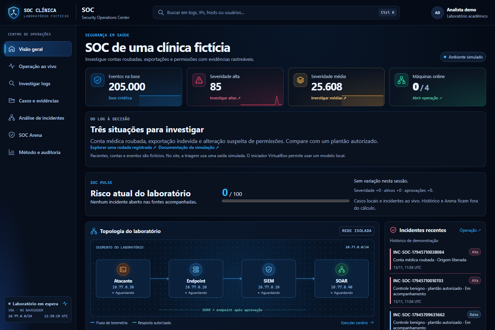
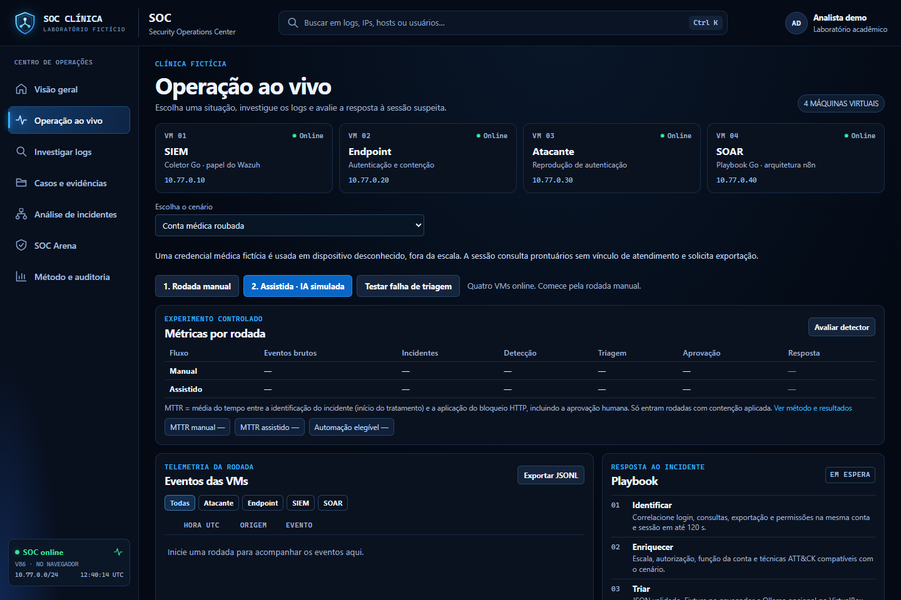
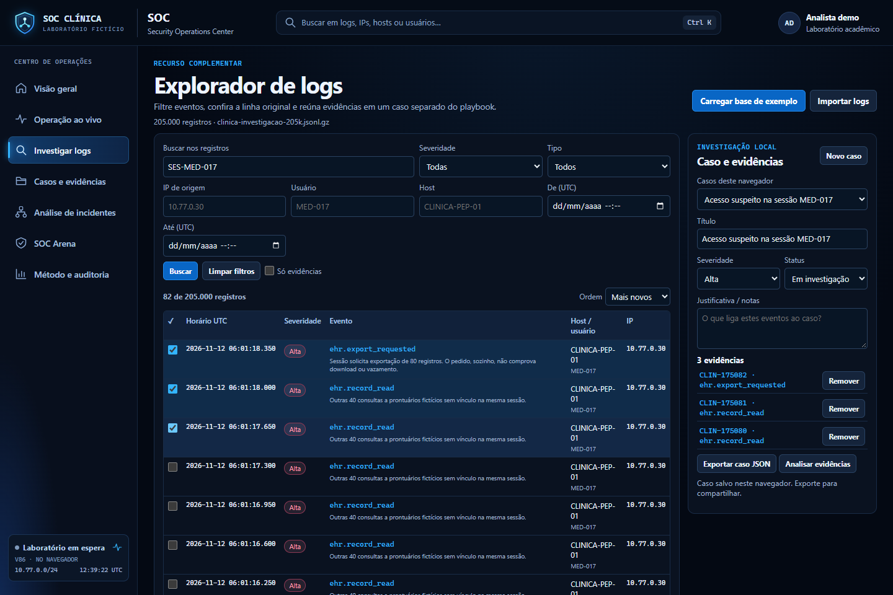
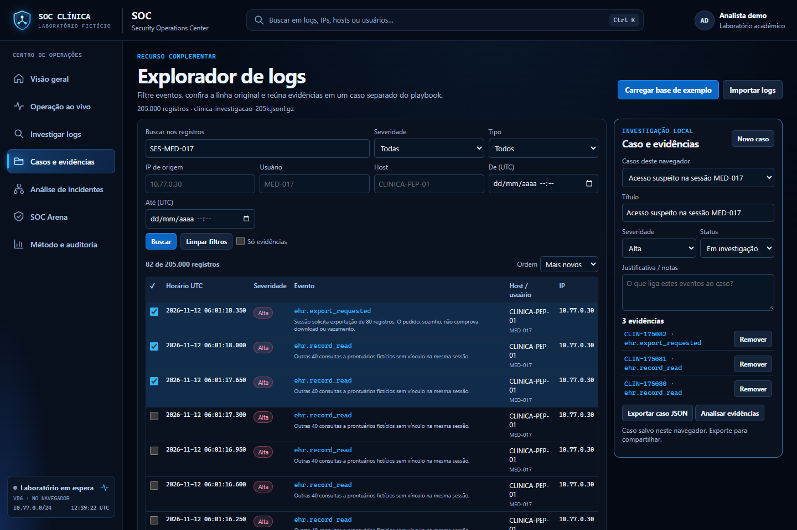
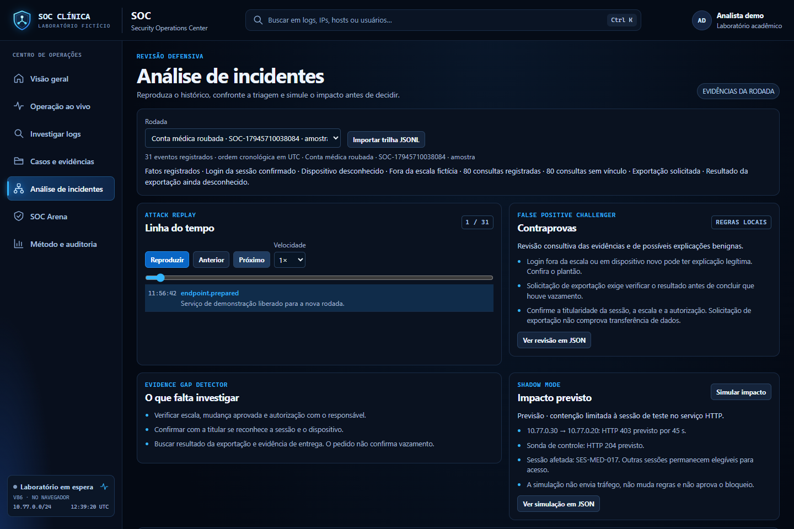
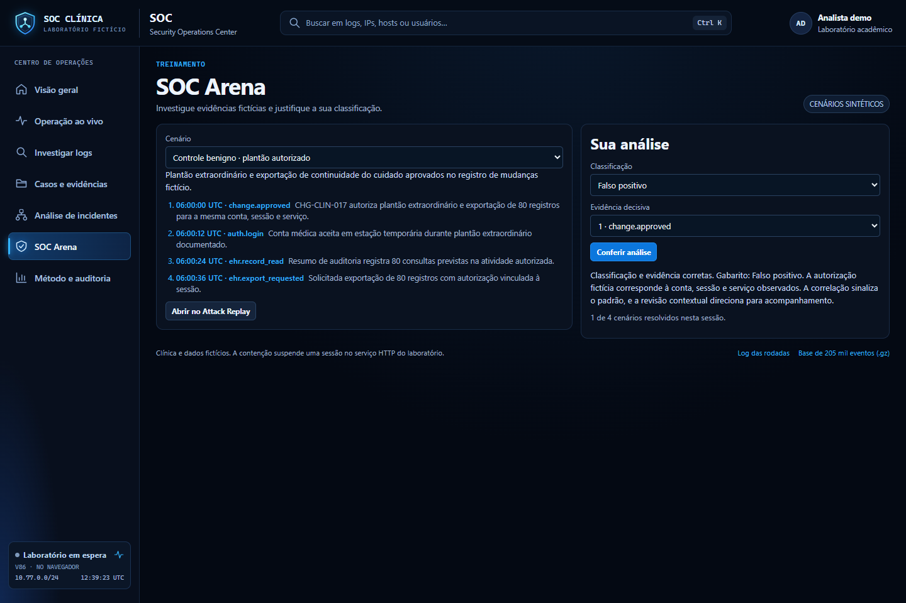
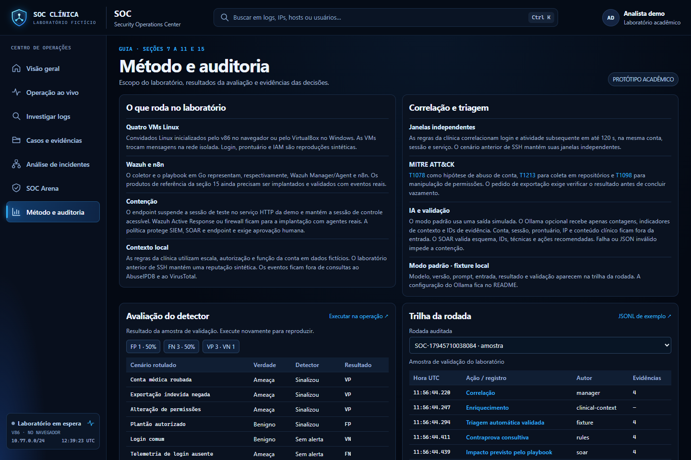

# SOC Clínica

Manual do repositório e das páginas

Atualizado em 13 de novembro de 2026.

[Demonstração](https://gustavobergz.github.io/soc-t1-automation/) · [Versão Word](docs/Manual_SOC_Clinica.docx) · [Documentação da simulação](DOCUMENTACAO_SIMULACAO.md)

## Conteúdo

1. [O projeto e a navegação](#secao-1)
2. [Arquitetura e tecnologias utilizadas](#secao-2)
3. [Visão geral](#secao-3)
4. [Operação ao vivo](#secao-4)
5. [Investigar logs](#secao-5)
6. [Casos e evidências](#secao-6)
7. [Análise de incidentes e revisão de evidências](#secao-7)
8. [Memória, comportamento e comprovante da decisão](#secao-8)
9. [SOC Arena](#secao-9)
10. [Método, auditoria e métricas](#secao-10)
11. [Execução e preparação da demonstração](#secao-11)
12. [Organização do código e dos dados](#secao-12)
13. [Relação com os materiais e limites da simulação](#secao-13)

<a id="secao-1"></a>

## 1 O projeto e a navegação

O SOC Clínica é um laboratório acadêmico de investigação e resposta a atividades suspeitas em uma clínica fictícia. Seu cenário principal é o uso de uma conta médica roubada. O sistema também reproduz exportação indevida, alteração de permissões e um plantão autorizado para comparação.

O analista acompanha os eventos, seleciona evidências, revisa a classificação e decide sobre uma contenção temporária. A IA local auxilia a triagem e a busca de contraprovas. Usuários, pacientes, prontuários, escalas e autorizações são inteiramente fictícios.

### Mapa das páginas

| Página | Rota | Finalidade |
| --- | --- | --- |
| Visão geral | [#visao-geral](https://gustavobergz.github.io/soc-t1-automation/#visao-geral) | Situar o analista, mostrar a base, a topologia e o risco acompanhado. |
| Operação ao vivo | [#operacao](https://gustavobergz.github.io/soc-t1-automation/#operacao) | Executar cenários nas quatro VMs e comparar os modos de triagem. |
| Investigar logs | [#investigar](https://gustavobergz.github.io/soc-t1-automation/#investigar) | Pesquisar os 205.000 eventos e selecionar registros individualmente. |
| Casos e evidências | [#casos](https://gustavobergz.github.io/soc-t1-automation/#casos) | Organizar a investigação, registrar uma conclusão e exportar o caso. |
| Análise de incidentes | [#analise](https://gustavobergz.github.io/soc-t1-automation/#analise) | Reproduzir a sequência, procurar contraprovas e conferir a decisão. |
| SOC Arena | [#arena](https://gustavobergz.github.io/soc-t1-automation/#arena) | Treinar classificação e escolha da evidência decisiva. |
| Método e auditoria | [#validacao](https://gustavobergz.github.io/soc-t1-automation/#validacao) | Consultar regras, política, rastreabilidade e métricas do experimento. |

### Duas formas de executar

No site público, o v86 executa quatro convidados Linux no navegador e as novas rodadas usam triagem simulada identificada. No Windows com VirtualBox, os mesmos papéis podem usar Ollama para inferência local real. As rodadas históricas com indicação Ollama reproduzem chamadas já executadas; essa indicação no histórico não significa uma nova chamada ao modelo pelo site público.

Este manual descreve a versão do código identificada nas referências finais. As imagens são capturas da demonstração publicada, em um perfil isolado, com evidências e casos fictícios criados para ilustrar a navegação.

Código de referência: [README.md](https://github.com/gustavobergz/soc-t1-automation/blob/4fe70d93d27ab42db2e1fa3f5be6650924aba3f7/README.md), [lab/investigation.js](https://github.com/gustavobergz/soc-t1-automation/blob/4fe70d93d27ab42db2e1fa3f5be6650924aba3f7/lab/investigation.js).

<a id="secao-2"></a>

## 2 Arquitetura e tecnologias utilizadas

O fluxo central é atividade fictícia → auditoria da clínica → correlação → triagem → revisão humana → resposta temporária → verificação e auditoria. A investigação histórica é carregada separadamente, sem enviar o arquivo completo ao modelo.

| Tecnologia | Uso efetivo no repositório |
| --- | --- |
| HTML5 e CSS3 | Estrutura do painel, navegação, tabelas, cartões, estados e layout adaptável. |
| JavaScript sem framework | Controle das sete páginas e dos componentes. A interface não depende de React. |
| Web Workers e Streams | Leitura e busca dos logs fora da execução principal da interface. DecompressionStream abre o arquivo gzip. |
| JSON, JSONL e gzip | Catálogo de cenários, eventos por linha, trilhas de demonstração e base compactada. |
| localStorage | Persistência dos casos e de conclusões revisadas no perfil do navegador. |
| Go | Aplicação das VMs, eventos, correlação, regras, política de resposta e validação da triagem. O módulo declara Go 1.25.0. |
| Node.js | Ponte local HTTP entre o painel, as portas seriais das VMs e o serviço Ollama; scripts de geração e preparação. |
| v86 e WebAssembly | Execução de convidados Linux no navegador, com imagens Buildroot e firmware de terceiros. |
| VirtualBox | Execução nativa das quatro VMs Linux na rede interna do laboratório. |
| Ollama e Qwen2.5 | Inferência local opcional. O configurador prepara Ollama 0.40.16 para CPU e qwen2.5:1.5b. |
| PowerShell e CMD | Configuradores, iniciadores e gerenciamento das VMs no Windows. |
| Python e pycdlib | Construção das imagens ISO usadas pelo modo VirtualBox. Não executam a triagem. |
| Git e GitHub Pages | Versionamento, distribuição do código e hospedagem da demonstração estática. |

### Papéis e limites da implementação

Os quatro convidados representam SIEM/coletor, aplicação da clínica, reprodutor de atividade e SOAR. Os serviços próprios em Go representam os papéis propostos para Wazuh e n8n. O repositório não instala Wazuh Manager, Agent, Dashboard, n8n ou Shuffle como produtos completos.

A base histórica é um arquivo JSONL compactado. Os casos usam armazenamento do navegador. Não há um banco SQL central nem treinamento do modelo com 205 mil logs. O tamanho da base não determina o tamanho da entrada da IA: somente um resumo estruturado do incidente selecionado é enviado.

Código de referência: [lab/go.mod](https://github.com/gustavobergz/soc-t1-automation/blob/4fe70d93d27ab42db2e1fa3f5be6650924aba3f7/lab/go.mod), [lab/virtualbox.cjs](https://github.com/gustavobergz/soc-t1-automation/blob/4fe70d93d27ab42db2e1fa3f5be6650924aba3f7/lab/virtualbox.cjs), [lab/ollama.cjs](https://github.com/gustavobergz/soc-t1-automation/blob/4fe70d93d27ab42db2e1fa3f5be6650924aba3f7/lab/ollama.cjs), [THIRD_PARTY_NOTICES.md](https://github.com/gustavobergz/soc-t1-automation/blob/4fe70d93d27ab42db2e1fa3f5be6650924aba3f7/THIRD_PARTY_NOTICES.md).

<a id="secao-3"></a>

## 3 Visão geral



Esta é a entrada do painel. Os cartões mostram quantos eventos existem na base carregada, quantos receberam severidade alta ou média e quantas VMs estão disponíveis. A topologia apresenta os quatro papéis e o fluxo de telemetria e resposta. Os incidentes recentes distinguem o histórico de demonstração das rodadas acompanhadas na sessão atual.

### Como usar e interpretar

Selecione os cartões de severidade para abrir uma investigação filtrada. Use a busca global para procurar conta, IP, host ou texto. A lista de eventos permite conferir o JSON original. Entre em Operação ao vivo para iniciar as VMs; o estado 0/4 na abertura não significa que o arquivo de 205 mil eventos deixou de carregar.

O SOC Pulse é um indicador didático de risco, de 0 a 100, calculado sobre casos locais e incidentes abertos da sessão. Sua composição fica visível: severidade, ativos envolvidos e aprovações pendentes. O histórico de demonstração e a Arena ficam fora do cálculo.

Os pesos são 18 para alta, 9 para média, 4 para baixa e 2 para incidente sem classificação, acrescidos de 4 por ativo distinto e 8 por aprovação pendente. A soma é limitada a 100. Encerrar casos ou registrar a resolução de rodadas concluídas pode reduzir o indicador.

O total de registros com severidade alta é uma contagem de eventos do arquivo. Ele pode incluir várias evidências do mesmo cenário. O Pulse acompanha outra população, por isso seus números não devem ser interpretados como uma divisão dos 205.000 eventos nem como uma medição global da segurança de uma clínica real.

Código de referência: [lab/dashboard.js](https://github.com/gustavobergz/soc-t1-automation/blob/4fe70d93d27ab42db2e1fa3f5be6650924aba3f7/lab/dashboard.js), [lab/review.js](https://github.com/gustavobergz/soc-t1-automation/blob/4fe70d93d27ab42db2e1fa3f5be6650924aba3f7/lab/review.js).

<a id="secao-4"></a>

## 4 Operação ao vivo



Esta página executa os cenários nas quatro VMs e mostra eventos, triagem, decisão, sondas e tempos. Há modo manual, modo assistido com saída simulada, Ollama local no iniciador compatível e teste de falha segura.

| Cenário | Prioridade de referência | Encaminhamento esperado |
| --- | --- | --- |
| Conta médica roubada | Alta | Revisar login, 80 consultas sem vínculo e pedido de exportação; solicitar aprovação se elegível. |
| Exportação indevida | Média | Investigar a tentativa de 250 registros recusada pela aplicação. |
| Alteração de permissões | Alta | Revisar concessão de administrador e uso da permissão sem mudança aprovada. |
| Plantão autorizado | Baixa | Conferir a autorização e acompanhar a atividade legítima. |

### Uma rodada do início ao fim

1. Aguarde as quatro VMs, selecione cenário e modo e inicie a rodada.
2. Confira os eventos. No modo manual, marque as evidências, identifique o incidente, escolha alta, média ou baixa e justifique.
3. Abra o JSON da triagem e compare a prioridade operacional da regra com a sugestão original do modelo.
4. Revise contraprovas e impacto previsto. Aprove ou rejeite somente a ação oferecida pela política.
5. Após aprovação elegível, confirme HTTP 403 na sessão suspensa e HTTP 204 na sessão legítima da mesma origem e no controle do SOAR.
6. Reverta antecipadamente ou acompanhe a expiração de 45 segundos. Confira auditoria e tempos.

A contenção suspende uma sessão de teste no serviço HTTP. Não revoga uma conta de prontuário real nem desfaz uma permissão corporativa. Alta severidade sozinha não autoriza bloquear: contexto autorizado e exportação já recusada levam a acompanhamento. A primeira triagem inválida impede a contenção assistida.

Código de referência: [lab/painel.js](https://github.com/gustavobergz/soc-t1-automation/blob/4fe70d93d27ab42db2e1fa3f5be6650924aba3f7/lab/painel.js), [lab/clinic.go](https://github.com/gustavobergz/soc-t1-automation/blob/4fe70d93d27ab42db2e1fa3f5be6650924aba3f7/lab/clinic.go), [lab/policy.go](https://github.com/gustavobergz/soc-t1-automation/blob/4fe70d93d27ab42db2e1fa3f5be6650924aba3f7/lab/policy.go).

<a id="secao-5"></a>

## 5 Investigar logs



A página carrega logs/clinica-investigacao-205k.jsonl.gz, com 205.000 registros fictícios. Cada linha descompactada é um objeto JSON independente. Um Web Worker processa a base, e a tabela mostra os resultados por páginas de 50 ou 100 registros.

### Uma investigação reproduzível

1. Aguarde o carregamento e pesquise SES-MED-017. A base atual retorna 82 registros dessa sessão: um login, 80 consultas individuais e um pedido de exportação.
2. Combine a busca com o tipo ehr.record_read para examinar as 80 consultas. Confira host, conta, sessão, horário e indicação de vínculo de atendimento.
3. Marque individualmente os registros úteis. Abra os detalhes para ler o JSON e use o pivô por IP para ampliar a investigação quando necessário.
4. Defina título, severidade e notas do caso. Salve a seleção para continuar em Casos e evidências ou analisar o conjunto escolhido.

A busca textual cobre IDs, tipo, mensagem, host, conta, IP, sessão, cenário e referência fictícia de prontuário. Ela pode ser combinada com filtros por severidade, tipo, IP, usuário, host e intervalo de datas UTC. Limpe filtros anteriores ao trocar a hipótese investigada.

A severidade de um evento é um campo do log. A severidade escolhida para um caso expressa a avaliação do analista sobre o conjunto de evidências. Alterar o caso não reescreve o arquivo histórico.

As consultas da base são individuais para permitir marcação uma a uma. No cenário ao vivo, essas mesmas consultas são resumidas em eventos com contagem. Portanto, quantidade de linhas e quantidade de prontuários consultados são medidas diferentes.

Código de referência: [lab/investigation.js](https://github.com/gustavobergz/soc-t1-automation/blob/4fe70d93d27ab42db2e1fa3f5be6650924aba3f7/lab/investigation.js), [lab/log-worker.js](https://github.com/gustavobergz/soc-t1-automation/blob/4fe70d93d27ab42db2e1fa3f5be6650924aba3f7/lab/log-worker.js), [lab/generate-clinic.cjs](https://github.com/gustavobergz/soc-t1-automation/blob/4fe70d93d27ab42db2e1fa3f5be6650924aba3f7/lab/generate-clinic.cjs).

<a id="secao-6"></a>

## 6 Casos e evidências



Esta página transforma uma seleção de logs em uma investigação revisável. Cada caso reúne título, severidade, status, notas, evidências e resolução. O analista pode manter o caso em investigação ou encerrá-lo, registrando confirmado, falso positivo ou inconclusivo conforme as evidências.

### Trabalho do analista

Comece com uma seleção na página Investigar logs. Dê um título que descreva a hipótese, registre o motivo da classificação e guarde somente as evidências pertinentes. Abra o caso para rever os JSONs e use Analisar evidências para encaminhar o conjunto selecionado à página de análise.

As alterações são salvas no armazenamento local do navegador. A chave utilizada é soc-tier1-cases-v1. Cada caso admite até 200 evidências e notas de até 2.000 caracteres. O arquivo JSON exportado reúne a investigação e permite guardar uma cópia para apresentação ou revisão.

O mesmo navegador e perfil recuperam os casos salvos em acessos posteriores. Trocar o perfil, usar janela privativa ou limpar os dados do site pode remover essa continuidade. A exportação é a forma disponível de conservar uma cópia fora do navegador; não existe sincronização de equipe ou banco central de casos.

### Resolução e memória

Uma conclusão revisada ajuda a comparar incidentes posteriores. Casos encerrados com resolução alimentam a SOC Memory; os abertos também participam do SOC Pulse. Escreva o raciocínio com precisão: pedido de exportação sem resultado conhecido não comprova vazamento, e atividade fora da escala pode exigir confirmação adicional.

O personagem de aprovação da demonstração é fixo, analista-demo. O sistema não oferece autenticação individual de analistas ou controle corporativo de permissões. Esses recursos precisam ser acrescentados antes de um uso operacional com pessoas e dados reais.

Código de referência: [lab/investigation.js](https://github.com/gustavobergz/soc-t1-automation/blob/4fe70d93d27ab42db2e1fa3f5be6650924aba3f7/lab/investigation.js), [lab/review.js](https://github.com/gustavobergz/soc-t1-automation/blob/4fe70d93d27ab42db2e1fa3f5be6650924aba3f7/lab/review.js).

<a id="secao-7"></a>

## 7 Análise de incidentes e revisão de evidências



Esta página reúne a revisão de uma rodada ao vivo, do histórico de demonstração, de um caso selecionado ou de uma trilha JSONL importada. O importador aceita arquivos de até 4 MB. A origem da análise e os eventos considerados devem ser conferidos antes de comparar conclusões.

### Replay e história do ataque

Attack Replay apresenta eventos em ordem cronológica UTC, com reproduzir, pausar, anterior, próximo, posição e velocidades de 1x, 2x ou 4x. É uma reprodução da trilha registrada: não repete o ataque na rede. Attack Story organiza os acontecimentos em etapas e mantém o vínculo com os JSONs de origem. A construção da linha do tempo é determinística.

### Contraprovas e lacunas

False Positive Challenger procura explicações alternativas, como plantão ou mudança autorizada. Pode usar regras locais ou uma segunda chamada ao Ollama. Essa revisão é consultiva, usa o mesmo modelo quando configurada e não constitui um verificador independente infalível.

Evidence Gap Detector aponta o que ainda precisa ser investigado, como reconhecimento da sessão pela titular, autorização da atividade e resultado da exportação. O checklist é calculado a partir das evidências; não depende de uma chamada livre ao LLM.

### Shadow Mode

Simular impacto mostra qual sessão seria suspensa e quais controles deveriam continuar acessíveis. A saída registra applied: false. A prévia não envia tráfego nem altera regras. O resultado descreve o serviço HTTP do laboratório; impactos em sistemas clínicos reais exigiriam inventário e integrações adicionais.

Código de referência: [lab/analysis.js](https://github.com/gustavobergz/soc-t1-automation/blob/4fe70d93d27ab42db2e1fa3f5be6650924aba3f7/lab/analysis.js), [lab/review.js](https://github.com/gustavobergz/soc-t1-automation/blob/4fe70d93d27ab42db2e1fa3f5be6650924aba3f7/lab/review.js), [lab/triage.go](https://github.com/gustavobergz/soc-t1-automation/blob/4fe70d93d27ab42db2e1fa3f5be6650924aba3f7/lab/triage.go).

<a id="secao-8"></a>

## 8 Memória, comportamento e comprovante da decisão

Os demais recursos de Análise de incidentes tornam a revisão rastreável e permitem comparar a hipótese com a atividade anterior. Cada recurso tem um papel específico; o uso de IA não se estende automaticamente a todos eles.

### SOC Memory e Incident DNA

A memória consulta resoluções revisadas de casos encerrados e rodadas registradas no navegador. Quando não há histórico aplicável, exemplos fictícios são identificados como sementes de demonstração. Isso é recuperação por similaridade, sem retreinamento dos pesos do modelo.

O Incident DNA deriva uma assinatura da sequência de eventos, técnicas MITRE e ativos. O IP fica fora da assinatura para permitir comparação quando a origem muda. A comparação usa sequência com peso de 75%, host 10%, conta 8% e técnicas 7%, com limiar 0,55 e até três resultados. A similaridade não é probabilidade de comprometimento e a assinatura não é um hash criptográfico.

### Behavioral Fingerprint

O perfil compara logins aceitos da conta no arquivo carregado. Com pelo menos 12 registros anteriores, verifica horários UTC raros, com frequência abaixo de 5%, e hosts já vistos. O indicador de escala dos cenários continua sendo um dado fictício do catálogo; não há integração com escala real de profissionais.

### Decision Receipt

O comprovante reúne IDs dos logs, regra, prioridade operacional, severidade sugerida pelo modelo, justificativa, validação e decisões da política e do analista. No modo local, inclui identificação do modelo, digest e versão do prompt. Permite exportar o resultado em JSON e contestar uma conclusão com base nas evidências. O registro não possui assinatura digital ou garantia de imutabilidade.

### Ask Your SOC

O campo de perguntas executa consultas estruturadas locais e mostra exemplos dos registros consultados. Ele não é um chat de linguagem livre conectado ao LLM.

| Pergunta de exemplo | Fonte e cuidado de interpretação |
| --- | --- |
| Quem acessou mais prontuários? | Agregação de consultas por conta na base carregada. |
| Quais exportações foram registradas? | Pedidos e recusas são eventos; não correspondem necessariamente a arquivos únicos entregues. |
| Quais permissões foram alteradas? | Eventos de concessão e acesso administrativo registrados. |
| Quais IPs tiveram mais falhas hoje? | Falhas de autenticação agrupadas, com data UTC da consulta. |
| Por que a severidade é alta? | Classificação e justificativa presentes no comprovante da análise atual. |

Código de referência: [lab/review.js](https://github.com/gustavobergz/soc-t1-automation/blob/4fe70d93d27ab42db2e1fa3f5be6650924aba3f7/lab/review.js), [lab/analysis.js](https://github.com/gustavobergz/soc-t1-automation/blob/4fe70d93d27ab42db2e1fa3f5be6650924aba3f7/lab/analysis.js).

<a id="secao-9"></a>

## 9 SOC Arena



A Arena é um treinamento interativo para o analista. Ela utiliza os quatro cenários do catálogo, apresenta a trilha e pede duas escolhas: classificação da situação e evidência decisiva. A correção compara ambas com o gabarito e explica o raciocínio técnico.

### Como treinar

1. Escolha um cenário e leia os eventos em ordem. Use a reprodução para examinar o momento de cada ação.
2. Decida entre ataque, falso positivo ou inconclusivo conforme a pergunta apresentada.
3. Selecione o evento que sustenta a sua decisão e confira a resposta.
4. Compare a explicação com o log original e tente os demais cenários.

Conta médica roubada exige cuidado com a atribuição: o enunciado informa a origem do exercício, mas os logs sozinhos não demonstram quem utilizou a credencial. Por isso, o gabarito pode ser inconclusivo sobre a confirmação do comprometimento, mesmo com risco alto e justificativa para investigar ou conter.

No plantão autorizado, a mudança aprovada sustenta a interpretação de falso positivo do alerta de comportamento. Na exportação indevida, uma recusa comprova a tentativa bloqueada, e não a saída dos dados. Na alteração de permissões, a concessão seguida de uso administrativo é a sequência que precisa ser examinada.

O contador de cenários resolvidos vai de zero a quatro e pertence à sessão de treinamento. As ações da Arena não aprovam bloqueios nem aumentam o SOC Pulse. O gabarito avalia uma resposta ao exercício; não é uma estimativa de precisão do modelo em produção.

Código de referência: [lab/arena.js](https://github.com/gustavobergz/soc-t1-automation/blob/4fe70d93d27ab42db2e1fa3f5be6650924aba3f7/lab/arena.js), [lab/clinic.json](https://github.com/gustavobergz/soc-t1-automation/blob/4fe70d93d27ab42db2e1fa3f5be6650924aba3f7/lab/clinic.json).

<a id="secao-10"></a>

## 10 Método, auditoria e métricas



A página reúne escopo, regras, tratamento da IA e avaliação controlada. Na operação, Avaliar detector executa oito casos com gabarito e apresenta resultados e trilhas exportáveis. Eles incluem incidentes, controle autorizado, login comum, ausência de telemetria, sessões diferentes e atividade fora da janela.

| Medida | Definição usada no projeto |
| --- | --- |
| MTTR | Média entre identificação do incidente e contenção aplicada, incluindo a espera de aprovação; somente rodadas contidas, separadas em manual e assistida. |
| Tempos intermediários | Detecção, triagem e aprovação aparecem separadamente para explicar a duração da resposta. |
| Taxa de automação | Triagens assistidas válidas divididas pelas rodadas assistidas que chegaram à triagem. Inclui a saída simulada identificada. |
| Falso positivo e falso negativo | Alerta em caso benigno e ausência de alerta em caso malicioso, segundo o gabarito da suíte do detector. |
| FPR e FNR | FP / (FP + VN) e FN / (FN + VP), respectivamente. Os denominadores são distintos. |
| Auditoria | Ator fictício, ação, horário UTC, evidências, aprovação, resultado e reversão; triagem acrescenta provedor, modelo e prompt. |

### Alcance do resultado

A suíte avalia a correlação antes da revisão contextual. Um plantão pode disparar o detector e depois receber prioridade baixa. Oito casos permitem reproduzir limites conhecidos, mas não sustentam uma alegação de acurácia em qualquer ambiente, nem medem sozinhos a qualidade do LLM.

As regras clínicas usam até 120 segundos após o login para relacionar ações da mesma conta, sessão e serviço. A autorização é contexto da triagem e da política. O laboratório SSH legado possui condições próprias. Consulta de privilégios com sudo -l, por si só, não demonstra exploração de vulnerabilidade e não deve ser apresentada como T1068.

Não use 30 minutos como resultado manual medido sem executar uma rodada correspondente. Registre valores observados, ambiente, modo de triagem e início e fim da medição. Os horários dos logs são UTC; a interface mede intervalos da rodada com o relógio de desempenho do navegador.

Código de referência: [lab/validation.js](https://github.com/gustavobergz/soc-t1-automation/blob/4fe70d93d27ab42db2e1fa3f5be6650924aba3f7/lab/validation.js), [lab/evaluation.go](https://github.com/gustavobergz/soc-t1-automation/blob/4fe70d93d27ab42db2e1fa3f5be6650924aba3f7/lab/evaluation.go), [lab/clinic.go](https://github.com/gustavobergz/soc-t1-automation/blob/4fe70d93d27ab42db2e1fa3f5be6650924aba3f7/lab/clinic.go).

<a id="secao-11"></a>

## 11 Execução e preparação da demonstração

### Navegador

Abra a demonstração publicada. Investigar logs e Análise de incidentes permitem explorar a base e as rodadas históricas. Ao entrar em Operação ao vivo, aguarde o início das quatro VMs v86 e escolha a triagem simulada. Use um navegador atual com WebAssembly, Workers e descompressão gzip disponíveis.

### Windows com VirtualBox e IA local

1. Baixe e extraia toda a pasta do repositório. Tenha VirtualBox e Node.js instalados.
2. Execute CONFIGURAR IA LOCAL.cmd. A preparação inicial utiliza internet, configura o Ollama para CPU e baixa qwen2.5:1.5b.
3. Execute INICIAR COM IA LOCAL.cmd. O painel é aberto em http://127.0.0.1:8771/.
4. Na operação, escolha Assistida · Ollama local. Confira provedor, modelo, prompt e JSON validado.
5. Faça uma rodada de ensaio antes de apresentar e conserve uma trilha exportada como apoio.

Reserve pelo menos 3 GB livres para a preparação. Ela baixa aproximadamente 46 MB de componentes CPU do Ollama, utiliza um ZIP temporário de cerca de 1,6 GB e baixa aproximadamente 986 MB de pesos. Os caminhos e a verificação do pacote estão fixados no configurador. Os tempos de inferência dependem do computador.

| Papel | IP interno | Responsabilidade |
| --- | --- | --- |
| Manager | 10.77.0.10 | Coleta, correlação e avaliação do detector. |
| Victim | 10.77.0.20 | Aplicação fictícia e suspensão da sessão de teste. |
| Attacker | 10.77.0.30 | Reprodução controlada dos cenários. |
| SOAR | 10.77.0.40 | Triagem, política, aprovação e resposta. |

As VMs usam a rede interna 10.77.0.0/24. A ponte do painel e o serviço de IA escutam no host em 127.0.0.1:8771 e 127.0.0.1:11434. O serviço local mantém recursos de nuvem desativados. Pesos e arquivos do Ollama ficam em %LOCALAPPDATA%\SOC-Tier1.

Para executar no VirtualBox com triagem simulada, use INICIAR VIRTUALBOX.cmd. Para encerrar as VMs criadas pelo projeto:

```powershell
powershell -File .\VirtualBox.ps1 -Mode Stop
```

Se a IA estiver indisponível, examine a preparação do modelo e use o modo simulado identificado para a apresentação. Uma triagem inválida deve permanecer sem contenção assistida. Os casos do navegador devem ser exportados antes de limpar o perfil.

Código de referência: [README.md](https://github.com/gustavobergz/soc-t1-automation/blob/4fe70d93d27ab42db2e1fa3f5be6650924aba3f7/README.md), [VirtualBox.ps1](https://github.com/gustavobergz/soc-t1-automation/blob/4fe70d93d27ab42db2e1fa3f5be6650924aba3f7/VirtualBox.ps1), [LocalAI.ps1](https://github.com/gustavobergz/soc-t1-automation/blob/4fe70d93d27ab42db2e1fa3f5be6650924aba3f7/LocalAI.ps1), [lab/ollama-cpu.json](https://github.com/gustavobergz/soc-t1-automation/blob/4fe70d93d27ab42db2e1fa3f5be6650924aba3f7/lab/ollama-cpu.json).

<a id="secao-12"></a>

## 12 Organização do código e dos dados

| Arquivo ou grupo | Responsabilidade |
| --- | --- |
| index.html e DEMO SOC.html | Entrada do site e estrutura das páginas do painel. |
| lab/painel.css e lab/assets | Tema, layout e escudo da identidade fictícia. |
| lab/dashboard.js e lab/painel.js | Visão geral, VMs, execução das rodadas e estados da operação. |
| lab/investigation.js e lab/log-worker.js | Rotas, tabela de logs, filtros, seleção e casos. |
| lab/analysis.js e lab/review.js | Replay, revisão, similaridade, memória, perfil, perguntas e comprovante. |
| lab/arena.js e lab/validation.js | Treinamento e visualização de métricas e auditoria. |
| lab/clinic.json e lab/clinic.js | Catálogo compartilhado e adaptação dos cenários no painel. |
| lab/soc.go e lab/clinic.go | Papéis das VMs, auditoria, regras clínicas e resumo das evidências. |
| lab/policy.go e lab/triage.go | Política, aprovação, contrato JSON e validação da triagem/revisão. |
| lab/evaluation.go | Casos controlados e avaliação do detector. |
| lab/virtualbox.cjs e lab/ollama.cjs | Servidor local, eventos das VMs e conector do modelo. |
| lab/emulator.js, lab/guest.js e lab/init.sh | Integração com o emulador e inicialização dos convidados. |
| lab/build-assets.cjs e lab/build-virtualbox.py | Preparação de imagens do navegador e ISOs do VirtualBox. |
| lab/generate-clinic.cjs e logs/ | Geração do arquivo de investigação e trilhas históricas. |
| README.md e LEIA-ME.md | Entrada do projeto e orientação rápida. |
| DOCUMENTACAO_SIMULACAO.md | Regras, cenários, privacidade e roteiro curto da simulação. |
| THIRD_PARTY_NOTICES.md | Componentes de terceiros e suas condições de licença. |

### Reproduzir a base

Na raiz do projeto, execute o gerador em Node.js. O primeiro comando produz a base compactada padrão; o segundo permite obter uma cópia JSONL sem compressão.

```powershell
node lab/generate-clinic.cjs
node lab/generate-clinic.cjs logs/clinica-investigacao-205k.jsonl
```

### Onde os dados ficam

O arquivo em logs/ é o histórico distribuído com o repositório. Casos e conclusões revisadas pertencem ao localStorage do navegador. A ponte nativa conserva um diário limitado de eventos em memória durante a execução. Exportar JSON é uma operação explícita do usuário; não há banco compartilhado de incidentes ou retenção central garantida.

Os arquivos e testes de SSH anteriores continuam no repositório para comparação. A existência de arquivos legados não muda o cenário clínico padrão nem significa que Wazuh e SOAR originais estejam instalados.

Código de referência: [lab/build-virtualbox.py](https://github.com/gustavobergz/soc-t1-automation/blob/4fe70d93d27ab42db2e1fa3f5be6650924aba3f7/lab/build-virtualbox.py), [lab/generate-clinic.cjs](https://github.com/gustavobergz/soc-t1-automation/blob/4fe70d93d27ab42db2e1fa3f5be6650924aba3f7/lab/generate-clinic.cjs), [lab/virtualbox.cjs](https://github.com/gustavobergz/soc-t1-automation/blob/4fe70d93d27ab42db2e1fa3f5be6650924aba3f7/lab/virtualbox.cjs).

<a id="secao-13"></a>

## 13 Relação com os materiais e limites da simulação

### Da proposta acadêmica à implementação

O TCC fornecido descreve o fluxo original de abuso de SSH, Wazuh, enriquecimento, LLM e resposta com aprovação. O texto de apresentação propõe uma abordagem mais ampla sobre segurança de agentes autônomos e impacto no negócio. O repositório atual é uma prova de conceito defensiva em saúde, com escopo delimitado e conta roubada como cenário principal.

| Tema dos materiais | Como aparece no repositório atual |
| --- | --- |
| Wazuh e SOAR | Papéis representados por serviços próprios em Go. Instalação e integração dos produtos originais ficam para outra etapa. |
| Threat intelligence | Contexto sintético no legado SSH; não há consultas operacionais a AbuseIPDB ou VirusTotal. O contexto clínico vem do catálogo fictício. |
| MITRE ATT&CK | T1078, T1213 e T1098 nas hipóteses clínicas; o legado SSH preserva seu próprio mapeamento. |
| Inteligência artificial | Triagem e revisão opcionais por Ollama. O site oferece saídas simuladas identificadas para novas rodadas. |
| Contenção e recuperação | Suspensão de sessão HTTP por 45 s, aprovação, sondas e reversão. Firewall, IAM e prontuário reais exigem conectores próprios. |
| Agentes autônomos | O painel demonstra apoio ao SOC e execução limitada por política. Não demonstra segurança universal de agentes nem autonomia irrestrita. |

### Dados e confiança no modelo

O conector envia contagens, indicadores, técnicas e IDs de evidência. Texto bruto, conta, IP, sessão e conteúdo clínico ficam fora da entrada. As evidências são tratadas como dados; recomendações têm valores predefinidos e o modelo não executa comandos. O JSON é validado quanto a campos, IDs, técnicas e ações. A primeira falha impede conter; falha da revisão consultiva permite contraprovas por regras locais.

A versão soc-clinic-3 inclui fatos derivados por código e referência de severidade. O painel conserva a proposta original do modelo separada da prioridade operacional. Validação estrutural não comprova que toda explicação é fiel. A revisão humana continua necessária, e executar localmente reduz transmissão externa sem garantir, por si só, ausência de vazamentos ou conformidade de uma implantação real.

### Uso na apresentação e referências

Apresente o problema da clínica, investigue a sessão SES-MED-017, salve um caso, mostre contraprovas e lacunas, execute uma rodada e compare sondas e tempos observados. Use o plantão autorizado para discutir falsos positivos. Relacione o resultado à redução de trabalho repetitivo e à continuidade do atendimento como objetivos a avaliar, sem inventar percentuais de ganho.

Base da documentação: código no commit 4fe70d93d27ab42db2e1fa3f5be6650924aba3f7, capturas de 13 de novembro de 2026, TCC_Autonomous_SOC_Tier1_Versao_Academica.docx e conteúdo textual pertinente da apresentação fornecida. Trechos de sessão e HTML do anexo foram excluídos. Os anexos originais não são redistribuídos.

[Repositório](https://github.com/gustavobergz/soc-t1-automation) · [Demonstração](https://gustavobergz.github.io/soc-t1-automation/) · [Documentação da simulação](https://github.com/gustavobergz/soc-t1-automation/blob/4fe70d93d27ab42db2e1fa3f5be6650924aba3f7/DOCUMENTACAO_SIMULACAO.md) · [Componentes e licenças](https://github.com/gustavobergz/soc-t1-automation/blob/4fe70d93d27ab42db2e1fa3f5be6650924aba3f7/THIRD_PARTY_NOTICES.md)

Código de referência: [lab/triage.go](https://github.com/gustavobergz/soc-t1-automation/blob/4fe70d93d27ab42db2e1fa3f5be6650924aba3f7/lab/triage.go), [lab/clinic.go](https://github.com/gustavobergz/soc-t1-automation/blob/4fe70d93d27ab42db2e1fa3f5be6650924aba3f7/lab/clinic.go), [lab/ollama.cjs](https://github.com/gustavobergz/soc-t1-automation/blob/4fe70d93d27ab42db2e1fa3f5be6650924aba3f7/lab/ollama.cjs).
